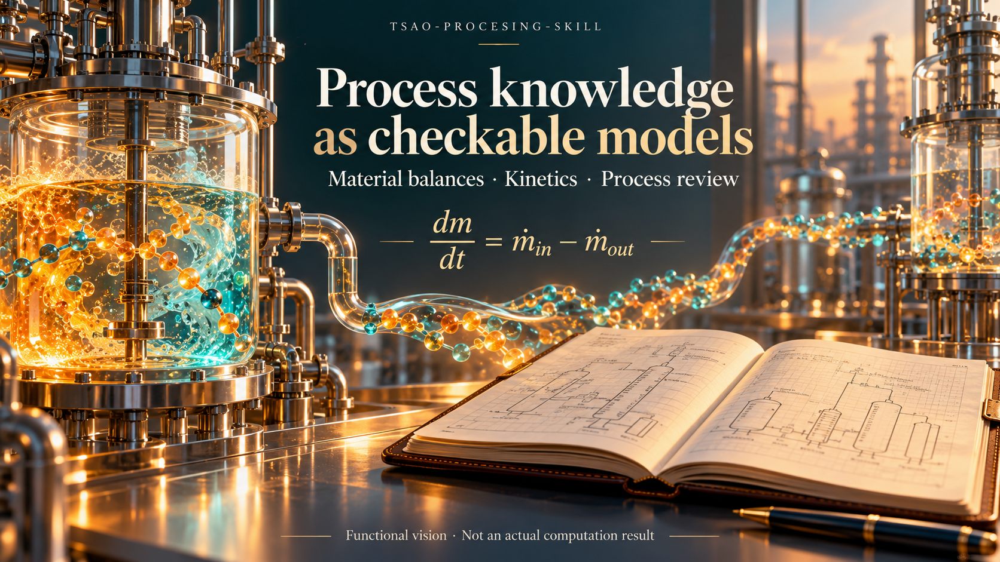

# TSAO Process Intelligence OS

[简体中文](README.zh-CN.md) · [Architecture](ARCHITECTURE.md) · [Capability matrix](docs/CAPABILITY_MATRIX.md) · [Visual system](docs/README_VISUAL_SYSTEM.md)



TSAO is a Python 3.11+ toolkit for chemical process development, dimensioned balances, EPDM/POE reference models, evidence records and conservative acceptance decisions. Four installable Skills share a CLI and source identity contract: `process-general`, `epdm`, `poe`, and `polymer-general`. The repository contains calculation and validation code, not an authenticated web service or a plant control system.

The illustration expresses the project vision. Its curves and molecules are conceptual, not measurements, calibrated predictions, or proof of industrial performance. The equations below identify their actual implementation and assumptions.

## What the code delivers

| Capability | Entry point | Result and limitation |
|---|---|---|
| Process-package review | [`validate_process_package`](tsao/process_package.py) | Topology, compositions, mass/component/energy residuals, decisions and evidence references; supplied-package software review |
| Quantity-aware material balance | [`evaluate_material_balance`](skills/poe/material_balance.py) | Explicit mass/molar basis, conversion, reactions, accumulation and componentwise tolerances |
| Decision tracks | [`derive_decision_tracks_from_root`](skills/poe/acceptance_status.py) | Separate software, engineering and HSE states; local artifact bytes must match declared SHA-256 |
| EPDM model contracts | [`canonical_loader.py`](skills/epdm/canonical_loader.py), [`numerical_integration.py`](skills/epdm/numerical_integration.py) | Versioned canonical records, reaction/state linkage and adaptive integration |
| POE reference kinetics | [`kinetics.py`](skills/poe/kinetics.py), [`estimation.py`](skills/poe/estimation.py) | RK4 trajectories and bounded one-parameter reference fitting; not industrial parameter release |
| Reproducibility and packaging | [`provenance.py`](tsao/provenance.py), [`skillpacks.py`](tsao/skillpacks.py) | Canonical source identities, four-Skill inventory and distribution containment |

### Current qualification and distribution boundary

`artifact_software_qualification=PASS` qualifies the tested source checkout and software contracts. Scientific, engineering, HSE, customer and industrial approvals require their own evidence. A matching hash proves file identity, not the truth of a measurement or the identity/authority of an approver.

The tracked historical source metadata remains controlled. Public wheel, sdist and source-snapshot generation is intentionally blocked with `BLOCKED_CONTROLLED_METADATA_CLASSIFICATION`; no classification is changed by this repair. CI tests that these commands fail without emitting a distributable artifact. Use the authorized source checkout until the relevant owner/legal/IP/security classification decision is recorded.

## Install and run

Use a standard virtual environment with no inherited system site packages. The existing CI matrix covers Python 3.11–3.14 on Windows and Ubuntu; results apply to the exact tested commit.

```bash
python -m venv .venv
# Linux/macOS: source .venv/bin/activate
# Windows PowerShell: .venv\Scripts\Activate.ps1
python -m pip install -e '.[dev]'
python scripts/verify_dependency_lock.py requirements.lock --pyproject pyproject.toml
python -m tsao.cli doctor --root . --profile core
python -m tsao.skillpacks --root .
python -m tsao.cli init --brief examples/generic-process/brief.yaml --out work/demo
python -m tsao.cli audit project --root work/demo
```

The generated project and template are starting records, not approved designs. Inspect their `status`, `errors`, `holds` and `reason_codes` before continuing.

```bash
python -m tsao.cli package template --family generic
python -m tsao.cli package audit --file path/to/process-package.json
python -m tsao.cli epdm validate-v2 --file skills/epdm/fixtures/v2_phase_a2_reference_project.json
python -m tsao.cli epdm canonicalize --file skills/epdm/fixtures/v2_phase_a2_reference_project.json --out work/canonical.json
```

`package audit` returns nonzero for a failed or held package. Duplicate JSON keys and non-finite JSON numbers are rejected rather than silently overwriting evidence. The default `STEADY_PROCESS` profile requires nonempty equipment/streams and explicit incoming/outgoing boundaries. `METADATA_ONLY` permits a document scaffold but reports `balance_status=NOT_EVALUATED` and cannot return overall `PASS`.

## Mathematical contracts mapped to code

### 1. Composition and process topology

For each stream, mass fractions obey

$$
0\le w_i\le1,\qquad \left|\sum_iw_i-1\right|\le\varepsilon_w,
\qquad \dot m_i=\dot m\,w_i.
$$

Every stream references a declared equipment item or an explicit boundary. Equipment inlet/outlet references must agree with the stream direction and must not duplicate a physical connection. See [`process_package.py`](tsao/process_package.py).

### 2. Steady mass and component closure

The generic package uses kg/h for mass flow and kW for enthalpy flow/duty. A component generation term must be supported by a declared reaction basis.

$$
r_m=\sum_{in}\dot m-\sum_{out}\dot m,
\qquad
r_i=\sum_{in}\dot m_i+G_i-\sum_{out}\dot m_i-C_i.
$$

The implemented relative residuals use an explicit reference floor of one in the canonical numeric basis:

$$
e_m=\frac{|r_m|}{\max(|\dot m_{in}|,|\dot m_{out}|,1)},
\qquad
e_i=\frac{|r_i|}{\max(\dot m_{i,in}+G_i,\dot m_{i,out}+C_i,1)}.
$$

The numeric floor is a scaling convention, not a dimensionless physical constant. Choose tolerances relative to the intended process scale; a zero residual does not establish that the supplied data are accurate.

### 3. Steady energy closure

$$
r_H=\sum_{in}\dot H+Q-\sum_{out}\dot H,
\qquad
e_H=\frac{|r_H|}{\max(|\dot H_{in}|+|Q|,|\dot H_{out}|,1)}.
$$

Positive duty adds heat under this convention. The reference model omits kinetic/potential energy unless represented consistently in the supplied enthalpy terms.

### 4. Dimensioned POE balance and units

The material-balance API accepts explicit `{value, unit, basis}` quantities, then converts mass to kg/s or amount of substance to mol/s. For molecular weight in g/mol,

$$
\dot n_i=\frac{1000\dot m_i}{M_i},\qquad
\dot m_i=\frac{M_i\dot n_i}{1000}.
$$

A reaction must satisfy the declared molar-mass contract when evaluated on a mass basis:

$$
\sum_i\nu_{ij}M_i\approx0,
\qquad R_i=\sum_j\nu_{ij}\dot\xi_j.
$$

This is a check against supplied molecular weights, not an elemental chemistry proof. Missing cross-basis molecular weights are an error.

$$
r_i=\dot N_{i,acc}-(F_{i,in}-F_{i,out}+G_i-C_i),
\qquad |r_i|\le a_i+r\,s_i.
$$

Here $a_i$ has the same flow unit as the residual, $r$ is dimensionless and $s_i>0$ is the declared component reference scale. Every component must pass; opposite component errors cannot cancel into overall acceptance. Steady mode requires an explicit steady-state declaration and exactly zero accumulation. Dynamic mode requires measured/modelled accumulation quantities.

### 5. Numerical range

[`numeric_contract.py`](tsao/numeric_contract.py) validates inputs and computed sums/products/quotients. Finite inputs can still overflow during aggregation. Nonzero conversions that underflow to zero are rejected. Public process-case/package auditors return `FAIL`; unavailable metrics remain JSON `null`. Direct numerical helpers raise `ValueError` (the v16 balance API uses its `ContractError` subclass). They do not substitute physical zero or emit JSON NaN/Infinity for an unrepresentable audited balance.

$$
\operatorname{isfinite}(x_{input})\ \not\Rightarrow\
\operatorname{isfinite}\!\left(\sum_i x_i\right).
$$

The public [`validate_process_case`](skills/poe/qualification.py) entry point checks the external-feed, external-product and declared-loss totals before evaluating

$$
e_{case}=\frac{|F_{external}-P_{external}-L_{declared}|}{F_{external}},
\qquad F_{external}>0.
$$

A non-representable total or residual is `FAIL`; a finite residual above the declared tolerance is `HOLD`. A content-qualified POE package passes its stored bytes and SHA-256 checks before this same numerical validator runs, so intact files cannot conceal an invalid balance. The v16/v17 compatibility balances also check unit conversion, residual summation and computed tolerances. Their existing canonical reference floors remain $10^{-30}$ and $1$, respectively; callers must choose dimensional absolute tolerance and dimensionless relative tolerance for the stated canonical units. These engineering conventions are not arbitrary-scale stoichiometric conservation tests.

[`process_general.py`](tsao/process_general.py) includes bounded reference calculations:

$$
A=\frac{\mathrm{MTBF}}{\mathrm{MTBF}+\mathrm{MTTR}},\qquad
X_{CSTR}=\frac{k\tau}{1+k\tau},\qquad
\eta_F=\frac{n z F}{I t},\quad F=96485.33212\ \mathrm{C\,mol^{-1}}.
$$

Availability scales the times before addition; CSTR conversion and Faradaic efficiency evaluate representable ratios without overflowing intermediate products. Equal positive MTBF/MTTR values therefore give $A=0.5$, including large numerical stress cases. A final nonzero result below floating-point range is rejected. Very large positive exposure in bounded CSTR/PFR conversion can legitimately round to one; this is distinct from silently replacing an unrepresentable flow with zero. Faradaic efficiency still requires positive electron count, current and time and rejects values above $1+10^{-9}$. These helpers retain their model assumptions and do not certify equipment reliability or electrochemical experiments.

The strict CSV entry point [`check_balance.py`](skills/polymer-general/scripts/check_balance.py) applies the same checked conversion and summation to every component and the total. It preserves a small residual through large cancelling flows and rejects a nonzero kg/h value that would become zero kg/s. Run `python skills/polymer-general/scripts/check_balance.py your-balance.csv`; invalid numerical contracts exit with code 2, while finite evaluated imbalances report `FAIL` and also exit 2.

[`tests/test_public_numeric_boundaries.py`](tests/test_public_numeric_boundaries.py) exercises these public calls and the real CSV command, including a POE package whose real file digest is updated after numerical damage, overflow/underflow failures, large finite cancellations, normal zero results and unchanged tolerance conventions.

JSON decoding is part of this numerical boundary. Project manifests, work-package matrices, gate ledgers, POE package records, caller-supplied EPDM state catalogs and both EPDM file-audit/canonicalization commands reject duplicate keys, non-finite numbers and nonzero decimal numbers that would become zero. In particular, a nonzero measurement uncertainty or declared loss cannot disappear before its semantic checks. True signed zeros, representable subnormals such as `5e-324`, and exact JSON integers remain valid. Rescale the physical quantity and its declared unit when an input is outside the supported floating-point range; do not replace it with zero. An already rounded Python float cannot reveal its original decimal source.

The compatibility helper [`mean_absolute_percentage_error`](tsao/contracts_v17.py) uses only nonzero observations:

$$
I=\{i:y_i\ne0\},\qquad
\mathrm{MAPE}_{fraction}=\frac{1}{|I|}\sum_{i\in I}\left|\frac{y_i-\hat y_i}{y_i}\right|.
$$

It returns `None` when $I$ is empty. The return value is a fraction (`0.1` means 10%), and zero observations are excluded rather than replaced by an arbitrary epsilon. Finite ratios and means are preserved when only an intermediate difference or sum overflows; an unrepresentable ratio raises `ValueError`. Check the number and relevance of nonzero observations before using this diagnostic for model selection. The new [decision-input](tests/test_decision_input_integrity.py) and [MAPE](tests/test_mape_range_integrity.py) regressions include actual CLI rejection and valid-input controls.

Source-identity audits support ordinary Git checkouts and linked worktrees. Git's `.git` directory or pointer file is excluded consistently, while tracked source configuration such as `.gitignore` remains in the inventory. Changing a local worktree pointer therefore cannot alter the audited software identity.

### 6. Adaptive integration and fitting

EPDM's Dormand–Prince pair compares each component before taking the maximum:

$$
e=\max_i\frac{|y_i^{(5)}-y_i^{(4)}|}
{a+r\max(|y_{n,i}|,|y_i^{(5)}|)}\le1.
$$

Step acceptance also requires valid linkage, finite states, nonnegative-state and conservation checks; time/step budgets can return `HOLD`. This is not a ratio of vector norms. POE reference kinetics uses the classical RK4 update

$$
y_{n+1}=y_n+\frac{h}{6}(k_1+2k_2+2k_3+k_4).
$$

The reference single-rate fit uses

$$
X(t;k)=1-e^{-kt}=-\operatorname{expm1}(-kt),\qquad
J(k)=\sum_i w_i[X(t_i;k)-X_i]^2,
\quad k_{min}\le k\le k_{max}.
$$

A local sensitivity/information diagnostic is

$$
S_i=t_i e^{-kt_i},\qquad I=\sum_iw_iS_i^2.
$$

Identifiability is conditional on the chosen model, observations and numerical threshold. It does not prove a globally unique kinetic mechanism or an externally qualified industrial parameter set.

## Decision and evidence strategy

The same conservative ordering is used for applicable decision records: explicit `FAIL` survives aggregation; `HOLD`, `CONDITIONAL`, unknown or unevaluated records cannot become `PASS`. The package reports both declared and recomputed states and a mismatch reason when appropriate.

For POE engineering/HSE evidence, a record needs `QUALIFIED`, `decision_use=true`, a named approver, a repository-relative artifact path and a matching SHA-256. Missing files, symlinks, path escapes, duplicate evidence IDs, conflicting `status/result` and malformed references do not qualify. Pure in-memory declarations without an artifact root remain unevaluated/held. Software result `status`, `errors`, `holds` and optional boolean `pass` must agree.

Use this sequence:

1. Register the source, original unit, method, uncertainty and applicability of each input.
2. Select the narrowest Skill and an explicit process profile; resolve topology and unit conversion first.
3. Close every component and energy balance before fitting or optimizing.
4. Fit against identified observations; reserve independent validation data and record parameter uncertainty.
5. Keep software checks, scientific model validation, engineering review and HSE review as separate decisions.
6. Repeat the full quality gates after any code/data change, retaining the commit and raw logs.

## Tests and delivery

```bash
python scripts/run_ci.py
python skills/epdm/scripts/audit_epdm.py
python skills/poe/scripts/audit_p0.py --root .
python skills/poe/scripts/audit_p1.py --root .
python scripts/sync_readme_visuals.py --check
# Expected containment failures while historical source metadata remains controlled:
python -m pip wheel --no-deps --no-build-isolation . -w wheelhouse
python scripts/export_source_snapshot.py --root . --out dist/source.zip
```

The unchanged 75% gate applies to the combined statement-and-branch percentage reported by `coverage.py` with branch tracing enabled. In [`scripts/run_ci.py`](scripts/run_ci.py), the measured scope is `skills.poe`, `skills.epdm`, `tsao.process_package`, and `tsao.skillpacks`; `skills/poe/scripts/*` and `skills/epdm/scripts/*` are omitted. New entrypoint regressions exercise negative decision states, empty topology, arithmetic overflow/underflow, malformed software results, local artifact tampering and duplicate JSON keys. Historical fixtures are synthetic software tests. Current results must be read from CI for the exact commit, not copied from an old badge.

The coordinating [seven-repository acceptance prompt](https://github.com/SUNHAOJUN22/TsaoSciResearcher/blob/main/docs/SEVEN_REPOSITORY_ACCEPTANCE_PROMPT.md) defines two three-hour successful-test-process segments per repository. A completed local regression does not mean that six-hour receipts exist. Segmented software regression is distinct from continuous plant/service operation or external solver certification.

## Historical performance reference

The following table is retained for its versioned historical comparison only. It is not a new measurement of this repair. Current CI reruns numerical parity and same-runner comparisons against its configured baseline, with all thresholds unchanged. See [performance evidence](reports/PERFORMANCE_TECHNOLOGY_REVIEW.md).

<!-- PERFORMANCE_RESULTS_START -->
| Workload | Baseline median | Optimized median | Ratio | Peak memory | Parity |
|---|---:|---:|---:|---:|---|
| EPDM three-level model, 64 site families | 129.96 µs | 131.24 µs | 0.99× | 37.23 KiB | exact |
| EPDM three-level model, 512 site families | 937.65 µs | 946.63 µs | 0.99× | 276.29 KiB | exact |
| EPDM semibatch material-energy step | 13.24 µs | 14.34 µs | 0.92× | 3.12 KiB | exact |
| EPDM semibatch trajectory, 10,000 public steps | 129.11 ms | 142.58 ms | 0.91× | 4.35 MiB | exact |
| EPDM screening, 1,000 scalar scenarios | 13.50 ms | 13.61 ms | 0.99× | 566.29 KiB | exact |
| POE RK4, 400 steps | 13.93 ms | 6.64 ms | 2.10× | 303.02 KiB | exact |
| POE RK4, 10,000 steps | 345.90 ms | 165.92 ms | 2.08× | 7.26 MiB | exact |
| POE finite-difference Jacobian, 8 × 200 | 503.52 µs | 493.41 µs | 1.02× | 33.92 KiB | exact |
| POE one-parameter fit, 401 points | 1.00 ms | 1.01 ms | 0.99× | 31.07 KiB | exact |
| POE dynamic response, 10,000 points | 241.69 µs | 241.34 µs | 1.00× | 569.67 KiB | exact |
| Universal process package, 500 equipment items | 4.43 ms | 4.38 ms | 1.01× | 179.53 KiB | exact |
| Universal process package, 5,000 equipment items | 44.28 ms | 44.12 ms | 1.00× | 1.95 MiB | exact |
| Source identity, 300 files build + verify | 25.91 ms | 24.80 ms | 1.04× | 424.10 KiB | exact |
| Source identity, 3,000 files build + verify | 228.88 ms | 229.13 ms | 1.00× | 1.68 MiB | exact |
| Repository Doctor, core profile | 126.28 ms | 129.83 ms | 0.97× | 1.29 MiB | tolerance / semantic |
| Four-Skill inventory | 5.95 ms | 6.35 ms | 0.94× | 137.26 KiB | tolerance / semantic |
| Wheel content verification | 2.93 ms | 3.13 ms | 0.94× | 593.27 KiB | tolerance / semantic |
| EPDM screening, 1,000 broadcast scenarios | 13.50 ms | 1.41 ms | 9.56× | 613.93 KiB | tolerance / semantic |
| EPDM semibatch trajectory, once-validated 10,000 steps | 129.11 ms | 47.21 ms | 2.73× | 4.35 MiB | exact |
| POE RK4 terminal-only, 10,000 steps | 345.90 ms | 143.77 ms | 2.41× | 5.59 KiB | tolerance / semantic |

| Scale pair | Normalized time ratio | Limit | Gate |
|---|---:|---:|---|
| EPDM three-level model, 64 site families → EPDM three-level model, 512 site families | 0.902 | 1.25 | PASS |
| Universal process package, 500 equipment items → Universal process package, 5,000 equipment items | 1.006 | 1.25 | PASS |
| Source identity, 300 files build + verify → Source identity, 3,000 files build + verify | 0.924 | 1.25 | PASS |
<!-- PERFORMANCE_RESULTS_END -->

## Governed visual atlas

The 32 existing deterministic SVGs remain an engineering/reference catalog. They describe architecture and contracts; they are separate from the language-specific AI concept image above and do not certify a calculation.

<details>
<summary>Open the source-controlled reference diagrams</summary>


</details>

## Responsibility

`main` is the authoritative branch. This toolkit supports reproducible calculations and review. Qualified process engineering, external property packages, experiments, equipment/relief design, HAZOP/LOPA/SIL, operating approval and customer acceptance remain independent requirements.
